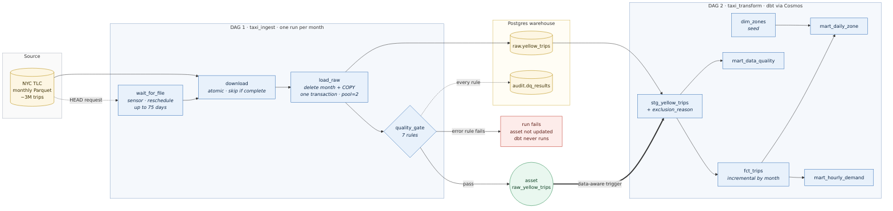
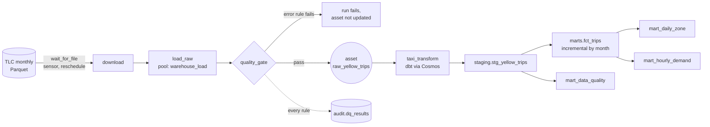
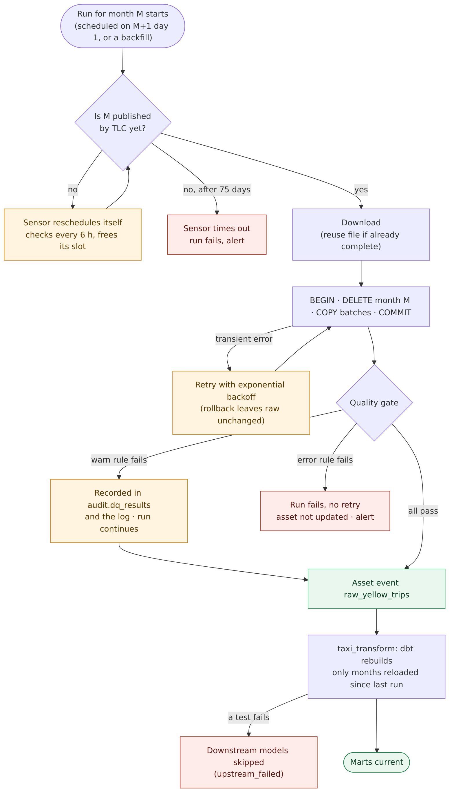
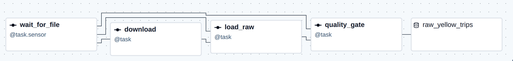
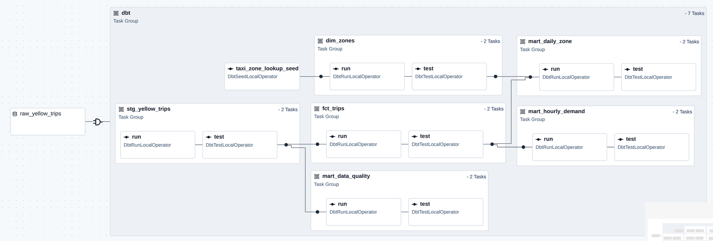
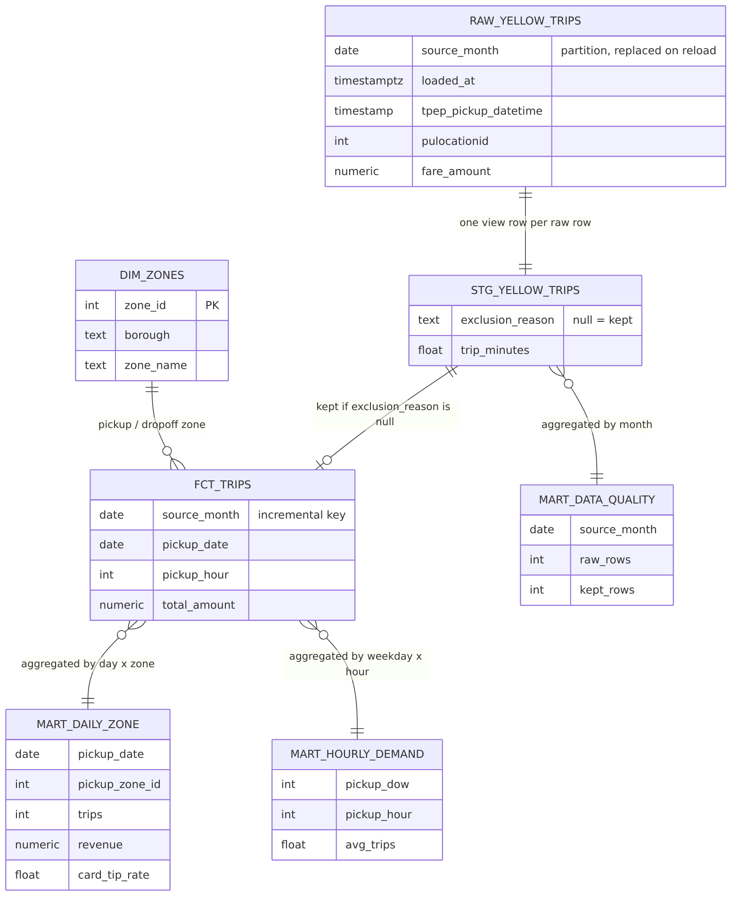
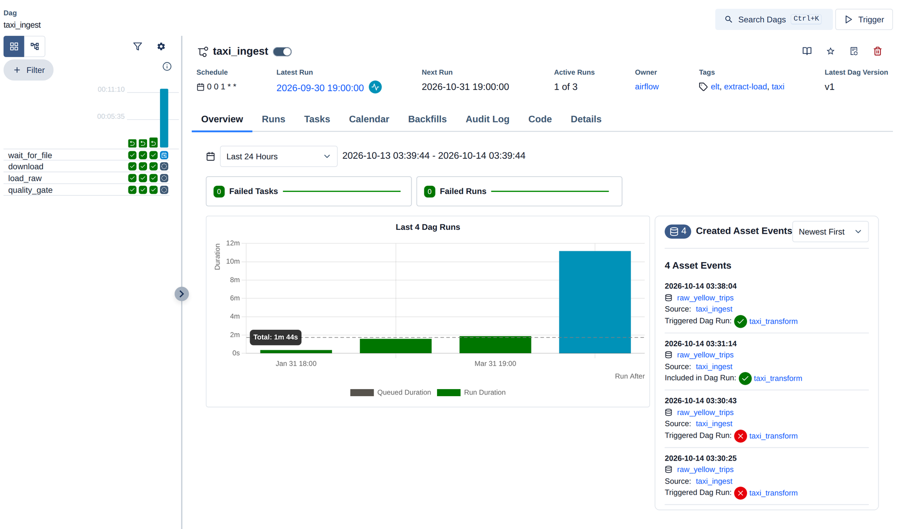
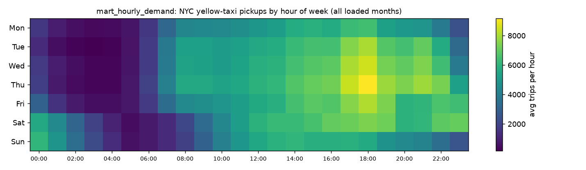
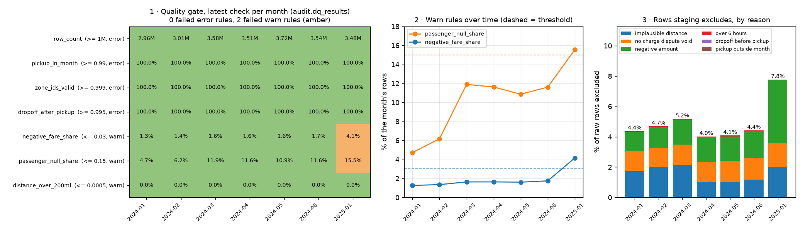

# airflow-elt: a production-shaped ELT pipeline on NYC taxi data

[](https://github.com/godot107/airflow-elt/actions/workflows/ci.yml)
[](https://github.com/godot107/airflow-elt/actions/workflows/cloudburn.yml)

Airflow 3 orchestrates a classic **extract → load → transform** warehouse: monthly NYC yellow-taxi trip files
land in Postgres, pass a data-quality gate, and dbt builds staging, a fact table and marts. Everything runs
locally with Docker Compose.

The point is not the taxi numbers. It is the orchestration habits that keep a pipeline correct when it is
rerun, backfilled, fed late or fed bad data:

| Problem every real pipeline hits | How this one handles it |
|---|---|
| A task is retried, or a month is reloaded | **Idempotent loads:** delete the month + `COPY` in one transaction. Reruns replace, never duplicate (tested). |
| History needs loading | Each run owns one **data interval** (a month), so `airflow backfill create` replays any range. |
| The source publishes late (TLC lags ~2 months) | A **rescheduling sensor** waits up to 75 days without holding a worker slot. |
| A bad file arrives | A **quality gate** between load and transform records every rule to an audit table and stops the run on a hard failure. `fct_trips` only takes months whose latest gate passed, so a bad month never reaches the marts, even when another month triggers dbt. |
| The source schema drifts | A **column contract**: case-insensitive mapping, casts, NULL for missing columns, unknown columns logged, missing required columns fail without retries. Adding a column to the contract adds it to the table on the next load (2025's congestion fee did). |
| Someone needs to know | **Alerts** on every failure and on warn-level data-quality findings, to a Slack-compatible webhook (log only when none is set). |
| Long backfills fill the disk | Each download is deleted once its month passes; a weekly **housekeeping DAG** clears stale files and old logs. |
| Downstream should run when data changes, not at 2 a.m. | **Data-aware scheduling:** the transform DAG is triggered by the `raw_yellow_trips` asset, which only a passing month updates. |
| Ten backfill months hit the database at once | A **pool** caps concurrent bulk loads at 2. |
| A transform silently drops rows | **dbt tests after each model** (Cosmos), including staging-matches-raw and mart-reconciles-to-fact, plus **dbt unit tests** of the cleaning, approval and incremental logic. |
| A change breaks something | **CI on every push:** ruff and sqlfluff, pytest, and dbt unit tests against throwaway Postgres containers. |

**Demo it:** [`notebooks/demo.ipynb`](notebooks/demo.ipynb) drives the whole story through Airflow's REST API
(load a month, read the gate's verdict, watch dbt start on the asset event, break a month on purpose, recover
it), with a talk track in [docs/DEMO.md](docs/DEMO.md).

## Architecture



<details><summary>Same diagram as Mermaid (source: <code>docs/diagrams/workflow.mmd</code>)</summary>


</details>

**What happens to one month**, including every failure path:



**`taxi_ingest`** (monthly data interval): `wait_for_file → download → load_raw → quality_gate → asset`.



**`taxi_transform`** (triggered by the asset): Cosmos renders every dbt model as a `run` task followed by its
`test` task, so a failed test stops exactly the models downstream of it.



| Layer | Object | Notes |
|---|---|---|
| raw | `raw.yellow_trips` | As published, conformed to the contract; `source_month`, `loaded_at` added |
| audit | `audit.dq_results` | One row per rule per load: value, threshold, severity, pass/fail |
| staging | `stg_yellow_trips` (view) | Renamed, typed, and an `exclusion_reason` for every row the marts drop |
| marts | `fct_trips` | Clean trips; **incremental**: rebuilds only months reloaded since its last run |
| marts | `dim_zones` | 265 TLC zones (seed) |
| marts | `mart_daily_zone` | Trips, revenue, average fare, card tip rate by day and pickup zone |
| marts | `mart_hourly_demand` | Average trips per hour of week |
| marts | `mart_data_quality` | Raw vs kept rows per month, by exclusion reason |



## Run it

Requires Docker with Compose v2 (about 4 GB of RAM for the stack).

```bash
make env                 # .env with random local secrets (gitignored)
make up                  # build the image, start Airflow + warehouse, wait until healthy
make backfill FROM=2024-01-01 TO=2024-03-31
make check               # lint + pytest + dbt unit tests (what CI runs)
```

Open http://localhost:8080 (user `admin`, password in `.env`). `make psql` opens the warehouse
(also on `localhost:5433`). `make down` stops the stack; `make nuke` also deletes both databases.

| Target | |
|---|---|
| `make test` | pytest inside the image: contract, faults, alerts, quality rules, housekeeping, DAG integrity, warehouse reload and contract evolution |
| `make dbt-unit` | dbt unit tests in `unit_*` schemas (never touches the real tables) |
| `make lint` | ruff + sqlfluff (needs both on the host; `pre-commit install` runs them on commit) |
| `make docs` | dbt docs site with the lineage graph on http://localhost:8081 |
| `make demo-bad-month MONTH=2024-06 FAULT=bad_zones` | load a month from a deliberately corrupted source and watch the gate stop it |
| `make demo-recover MONTH=2024-06` | remove the fault and rerun the month from `load_raw` |
| `make notebook` | the demo notebook (`pip install -r notebooks/requirements.txt` on the host) |
| `make dbt ARGS="..."` | any dbt command against the warehouse |

Alerts: set `ALERT_WEBHOOK_URL` in `.env` to a Slack (or compatible) incoming webhook and restart.

Regenerate the visuals: diagrams with
`docker run --rm -u $(id -u):$(id -g) -v $PWD/docs:/data minlag/mermaid-cli:11.17.0 -i /data/diagrams/workflow.mmd -o /data/img/workflow.png -c /data/diagrams/config.json -b white -s 2`
(same for `month_lifecycle`, `layers`), charts with `python scripts/charts.py` (needs pandas + matplotlib).

### Demo on AWS (on demand, no standing infrastructure)

`infra/demo.yaml` runs the same stack on one Graviton EC2 instance for the length of a demo, about $0.30
for four hours: `deploy/preflight.sh`, `deploy/up.sh`, `deploy/smoke.sh`, `deploy/tunnel.sh` (Airflow and
the warehouse on localhost over SSM, no open ports, so the notebook works unchanged), `deploy/down.sh`. The instance terminates itself after `MAX_HOURS` in case `down.sh` is forgotten.
Runbook, cost table and why there is no cloud schedule: [deploy/README.md](deploy/README.md).

## What a run shows

Backfilling January–March 2024 (`make backfill FROM=2024-01-01 TO=2024-03-31`):



| Month | Raw trips | Load (COPY) | Quality gate | Kept in `fct_trips` | Excluded |
|---|---|---|---|---|---|
| 2024-01 | 2,964,624 | ~16 s | 7/7 rules pass | 2,834,740 | 4.4% |
| 2024-02 | 3,007,526 | ~15 s | 7/7 rules pass | 2,866,123 | 4.7% |
| 2024-03 | 3,582,628 | ~32 s | 7/7 rules pass | 3,397,149 | 5.2% |

- **The live schedule waits correctly.** Unpausing also created the run for the latest interval (September
  2026); TLC has not published it, so its sensor sits in `up_for_reschedule` without holding a slot.
- **Reruns are idempotent, on real data.** Clearing January's `load_raw` reloaded the month: raw stayed at
  2,964,624 rows, the asset event re-triggered `taxi_transform`, and `fct_trips` rebuilt **only January**
  (still 2,834,740 rows; February and March kept their original `loaded_at`).
- **The tests caught real bugs during the build**, which is what they are for: the loader used psycopg2's
  `copy_expert` but the Postgres provider 7.x hook returns psycopg 3 (the integration test now goes through
  the same hook as the DAG), and a cross-model dbt test first ran before the mart it checks existed (fixed by
  attaching it to the mart and using `buildable` test selection).

The marts answer ordinary questions: Manhattan is 90% of trips; Queens pickups average $73 a trip (the
airports); demand peaks on weekday evenings, Thursday 6 pm the busiest hour.



## Data validation: four layers

Validation happens at four points, each with a different job:

| Layer | Where | What it checks | On failure |
|---|---|---|---|
| **1. Schema contract** | `load_raw` (`include/taxi/load.py`) | Required columns present; names mapped case-insensitively; types cast to the contract; unknown columns logged | Missing required column: task fails before anything is written |
| **2. Quality gate** | `quality_gate` (`include/taxi/quality.py`, rules in `config.py`) | 7 rules on the loaded month: row count, pickups inside the month, valid zone ids, dropoff after pickup (error); negative fares, missing passenger counts, distances over 200 miles (warn). Every result goes to `audit.dq_results` | Error rule: run fails with no retry, the asset is not updated, dbt never sees the month. Warn rule: recorded and logged |
| **3. Approval** | `approved_months` (dbt) | A month reaches `fct_trips` only if its latest gate check passed every error rule **and** is newer than its latest load | The month keeps its last approved rows in the marts |
| **4. dbt tests** | after each model (`dbt/taxi/models/*.yml`, `macros/tests.sql`, `tests/`) | 18 data tests: not-null, unique, accepted values, zone relationships, trip duration range, one row per day×zone, **staging row count equals raw**, **mart trips and revenue reconcile to the fact table**; plus 4 **unit tests** on fixed rows (exclusion reasons, approval, incremental selection) | Downstream models are skipped (`upstream_failed`) |

Staging also labels every row it drops with one `exclusion_reason`, and `mart_data_quality` counts them, so
"cleaning" is auditable instead of a silent `WHERE`.



## Data quality: what real data looks like

The gate's thresholds come from measuring the files, not from wishing them clean
([docs/data_notes.md](docs/data_notes.md)):

- **About 1–2% of fares are negative.** They are reversals (most are "no charge" or "dispute" payments), so a
  zero-tolerance rule would fail every month. The gate warns above 3%.
- **Missing passenger counts rose from 4.7% to 11.9% in Q1 2024.** That looks like a degrading feed, but a row
  lacks a passenger count *exactly* when its payment type is 0 (flex fare): the rising share is flex-fare trips
  growing. Warn rule, not a stop.
- **The schema drifts:** `airport_fee` (2023) becomes `Airport_fee` (2024), `passenger_count` changes type,
  and 2025 adds `cbd_congestion_fee` for Manhattan congestion pricing. The contract absorbs the first two; the
  third was added to the contract, and loading January 2025 added the column to the table (NULL for 2024).
- **January 2025 tripped both warning rules:** 4.2% negative fares (from 1.3–1.6%) and 15.5% missing
  passenger counts. The rise is in flex-fare trips from one vendor. The month loaded, and the alert says so:
  that is the difference between a warn rule and an error rule.

## Design decisions

- **LocalExecutor**, not Celery: a single machine needs no Redis or worker containers, and the scheduling
  semantics (pools, retries, sensors, assets) are identical. Celery or Kubernetes is a config change.
- **An explicit `CronDataIntervalTimetable`.** Airflow 3 defaults cron schedules to trigger timetables with no
  data interval; this pipeline needs each run to own a month.
- **Quality gate in Python + SQL, tests in dbt.** The gate protects the warehouse at load time and writes an
  audit trail; dbt tests protect the transformations. A failed gate rule is a data problem, so `quality_gate`
  has no retries.
- **dbt in its own virtualenv** inside the image, so dbt's dependency pins never fight Airflow's constraints.
  The project uses no dbt packages (two small generic tests live in `macros/tests.sql`), so runs need no network.
- **Cosmos with `buildable` test selection.** A test that spans two models (mart reconciles to fact) runs after
  the later one instead of failing with the first.
- **Approval in the warehouse, not only in the scheduler.** The asset event already keeps dbt from running
  on a failed month, but another month's event can still start dbt; `approved_months` makes the rule hold
  whatever triggers the run.
- **Fault injection by Airflow Variable**, so the failure path can be shown on real data without editing
  code, and is off unless someone sets it.
- **Import CTEs in dbt models** (`with stg as (select * from ref(...))`): dbt's `--empty` mode, used to build
  unit-test parents, wraps each `ref()` in an aliased subquery, so `ref(...) as s` would break it.

## Layout

```
dags/                taxi_ingest.py, taxi_transform.py, taxi_housekeeping.py
include/taxi/        config (contract, rules), extract, load, quality, faults, alerts, assets
dbt/taxi/            models/staging (+ approved_months), models/marts, unit tests, seeds, macros, tests, profiles.yml
tests/               pytest, run inside the Airflow image
notebooks/           demo.ipynb (+ build_notebook.py, airflow_demo.py REST client, requirements.txt)
scripts/             make_env.py (.env secrets), ensure_tables.py, charts.py (README charts from the warehouse)
docs/                DEMO.md (talk track), data_notes.md (measured source properties), diagrams/*.mmd, img/
.github/workflows/   ci.yml (lint, pytest, dbt unit tests), cloudburn.yml (IaC cost scan)
docker-compose.yaml  adapted from the official Airflow 3.3.2 compose file
infra/               demo.yaml (EC2 demo stack), cost.yaml (budget alert); scanned by CloudBurn in CI
deploy/              preflight.sh, up.sh, smoke.sh, tunnel.sh, extend.sh, logs.sh, down.sh, deploy_cost.sh; README.md
```

## Data and license

[NYC TLC Trip Record Data](https://www.nyc.gov/site/tlc/about/tlc-trip-record-data.page), downloaded at run
time and never committed (only the 12 KB zone lookup is). Code: MIT.

## References

- Apache Airflow 3.3 documentation: [Running Airflow in Docker](https://airflow.apache.org/docs/apache-airflow/3.3.2/howto/docker-compose/index.html),
  [Asset-aware scheduling](https://airflow.apache.org/docs/apache-airflow/3.3.2/authoring-and-scheduling/asset-scheduling.html),
  [Backfill](https://airflow.apache.org/docs/apache-airflow/3.3.2/core-concepts/backfill.html),
  [Best practices](https://airflow.apache.org/docs/apache-airflow/3.3.2/best-practices.html).
- [Astronomer Cosmos](https://astronomer.github.io/astronomer-cosmos/): dbt projects as Airflow task groups.
- [dbt incremental models](https://docs.getdbt.com/docs/build/incremental-models) and
  [data tests](https://docs.getdbt.com/docs/build/data-tests).
- M. Beauchemin, [Functional Data Engineering](https://maximebeauchemin.medium.com/functional-data-engineering-a-modern-paradigm-for-batch-data-processing-2327ec32c42a) (2018):
  idempotent, partition-replacing tasks.
- [NYC TLC yellow-taxi data dictionary](https://www.nyc.gov/assets/tlc/downloads/pdf/data_dictionary_trip_records_yellow.pdf).
